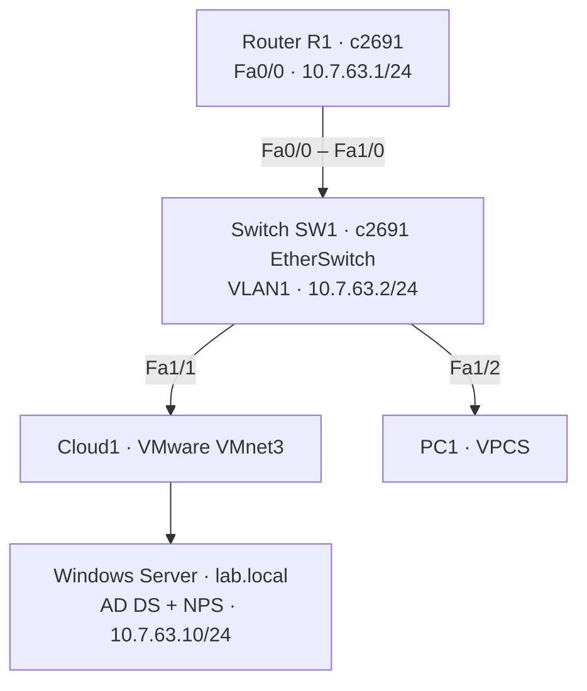

# Tarea Semana 6 — Asignación 2

**Seguridad de Redes · Laboratorio individual: Cisco AAA + Active Directory + NPS / RADIUS**

> 🎥 **VIDEO DEMOSTRATIVO (YouTube, máximo 10 minutos):** pendiente de agregar.
> **Estado:** autenticación/autorización de los niveles 0, 5 y 10 comprobada en R1 y SW1. Las imágenes completas, los running-config completos depurados y el video quedan pendientes de incorporar.

## Propósito
Desplegar autenticación, autorización y contabilidad (AAA) centralizadas para un router y un switch Cisco en GNS3 mediante Windows Server AD DS y Network Policy Server (NPS) como servidor RADIUS. Los grupos de Active Directory controlan los niveles de privilegio 0, 5 y 10.

## Topología

Diagrama independiente: [diagramas/topologia.svg](diagramas/topologia.svg). El c2691 empleado como SW1 tiene un módulo EtherSwitch; no es la imagen vIOS-L2.

## Direccionamiento
| Equipo | Dirección IPv4 | Función |
| --- | --- | --- |
| R1 | `10.7.63.1/24` | Cliente RADIUS |
| SW1 | `10.7.63.2/24` | Cliente RADIUS / VLAN 1 |
| Windows Server | `10.7.63.10/24` | AD DS y NPS |
| Red de laboratorio | `10.7.63.0/24` | VMware VMnet3 |
| RADIUS | UDP 1812 / 1813 | Autenticación / contabilidad |

## Grupos y privilegios
| Usuario de dominio | Grupo Active Directory | Política NPS | Atributo Cisco |
| --- | --- | --- | --- |
| `usuario0` | `NET-NIVEL-0` | `POLITICA-NIVEL-0` | `shell:priv-lvl=0` |
| `usuario5` | `NET-NIVEL-5` | `POLITICA-NIVEL-5` | `shell:priv-lvl=5` |
| `usuario10` | `NET-NIVEL-10` | `POLITICA-NIVEL-10` | `shell:priv-lvl=10` |

En las políticas NPS se utiliza **Cisco-AV-Pair**, no un atributo `Vendor-Specific` genérico mal formado.

## Evidencia de pruebas
| Comprobación | R1 | SW1 |
| --- | --- | --- |
| RADIUS Access-Accept | Confirmado | Confirmado |
| Privilegio 0 | Cisco AVPair + autorización EXEC | Cisco AVPair + autorización EXEC |
| Privilegio 5 | `show privilege` = 5 | `show privilege` = 5 |
| Privilegio 10 | `show privilege` = 10 | Probado en sesión; captura pendiente de subir |
| SSH con usuario local `adminlocal` | Confirmado | Confirmado |
| Accesos consola | AAA configurado y probado | AAA configurado y probado |
| Línea AUX | Detectada / configuración mostrada | Detectada; captura de configuración completa pendiente |
| Logs de autenticación y contabilidad | Registrados | Registrados |

**El `show privilege` no está disponible por defecto en nivel 0**; por eso su evidencia es el paquete `Access-Accept`, `Cisco AVpair [1] "shell:priv-lvl=0"` y la autorización EXEC exitosa.

## Organización
- [docs/informe-tecnico.md](docs/informe-tecnico.md): informe de implementación, pruebas, correcciones, límites y conclusiones.
- [diagramas/](diagramas/): diagrama editable y SVG.
- [configuraciones/](configuraciones/): fragmentos sanitizados **NO equivalentes a running-config completos**.
- [scripts/verificar-ad-nps.ps1](scripts/verificar-ad-nps.ps1): verificaciones de solo lectura en Windows.
- [evidencias/INDICE.md](evidencias/INDICE.md): listado de capturas para incorporar.

## Antes de entregar
Completar: **video al inicio de este README**, imágenes del paquete local, running-config íntegros depurados, evidencia final de AUX/SW1, fecha y hora de la demostración, relación entre IP y matrícula, y nombre reglamentario del TXT. La tarea es individual.

### Seguridad
Las contraseñas y secretos RADIUS expuestos durante el diagnóstico **no se publican**. Rotarlos antes de compartir el repositorio. IOS 12.4 y los algoritmos SSH heredados, así como PAP en esta práctica, corresponden a un laboratorio aislado y no a una configuración adecuada para producción.
