# Informe técnico — Implementación de AAA centralizado en Cisco con AD DS y NPS

**Curso:** Seguridad de Redes  
**Actividad:** Tarea Semana 6, Asignación 2  
**Entorno:** GNS3, VMware Workstation, Windows Server y Cisco IOS  
**Fecha de documentación:** 30 de octubre de 2026

## 1. Resumen
Se construyó una infraestructura con un router y un equipo Cisco configurado como switch EtherSwitch, conectados a Windows Server por una red virtual VMware. Se integró Active Directory con NPS/RADIUS para la autenticación y autorización de acceso administrativo por consola, y se definieron tres grupos de seguridad con privilegios 0, 5 y 10. Se mantuvo acceso SSH local de recuperación y se habilitaron registros de eventos.

## 2. Propósito y alcance
Implementar **AAA** (autenticación, autorización y contabilidad) en consola y AUX, integración NPS como cliente RADIUS, un usuario local administrativo y servicio SSH, y documentar evidencia reproducible. La conexión AUX fue configurada pero su prueba de acceso físico no se demostró. Las políticas 0, 5 y 10 se verificaron en consola mediante `show privilege` o depuración RADIUS, según el privilegio disponible.

## 3. Diseño lógico
- Router R1: Cisco c2691, `FastEthernet0/0` con `10.7.63.1/24`.
- SW1: c2691 con módulo EtherSwitch, interfaz `Vlan1` con `10.7.63.2/24`.
- Windows Server `lab.local`: `10.7.63.10/24` por red virtual VMware VMnet3.
- NPS: UDP 1812 (autenticación) y 1813 (contabilidad), con clientes `R1-CISCO` y `SW1-CISCO`.
- PC1: VPCS, host auxiliar; IP no documentada.

## 4. Identidad y control de privilegios
Se crearon los grupos AD `NET-NIVEL-0`, `NET-NIVEL-5` y `NET-NIVEL-10`. Cada grupo tiene un usuario dedicado y una política NPS correspondiente. En las políticas, el atributo Cisco específico `Cisco-AV-Pair` devuelve `shell:priv-lvl=0`, `shell:priv-lvl=5` o `shell:priv-lvl=10`. El código de fabricante es 9, el tipo interno del atributo es 1. La etiqueta local de NPS puede mostrar el número de definición 5000; no debe confundirse con el tipo del atributo RADIUS en el paquete.

## 5. Cisco IOS y AAA
Se utilizaron listas `CONSOLE-RADIUS` para autenticación, `CONSOLE-EXEC` para autorización EXEC y `CONSOLE-ACCT` para contabilidad, aplicadas a la consola y configuradas también en AUX. Se habilitó `aaa authorization console`. VTY/SSH emplea `SSH-LOCAL` y `SSH-EXEC` con cuenta local `adminlocal` y nivel 15. Las configuraciones exactas deben comprobarse en los running-config completos antes de entregar.

Registros activados: `login on-success log`, `login on-failure log`, `service timestamps log datetime msec` y `logging buffered 16384 informational`. Para validar se utilizaron `show logging`, `show radius statistics`, `show ip ssh` y `show line`.

## 6. Incidencias y soluciones
1. La consola vIOS-L2 permanecía negra, por lo que se empleó c2691 con módulo EtherSwitch para SW1.
2. Se corrigió conectividad entre GNS3 Cloud y el Windows Server VMnet3.
3. NPS no estaba escuchando inicialmente en `10.7.63.10`; se ajustó la IP de escucha y reinició IAS controladamente, considerando la dependencia de `TSGateway`.
4. Pruebas RADIUS fallaban por claves/credenciales no coincidentes; finalmente se observaron `Access-Accept` y estadísticas de respuesta.
5. Las autorizaciones mostraban nivel 1 al utilizar un VSA mal formado: `Unsupported cisco VSA 9; IGNORE`. Al utilizar **Cisco-AV-Pair** correcto, se procesaron `priv-lvl=5`, `priv-lvl=10` y `priv-lvl=0`.
6. La prueba `show privilege` no está disponible para usuario de nivel 0; se validó con `debug radius` y `debug aaa authorization`.

## 7. Resultados medidos
| Prueba | R1 | SW1 |
| --- | --- | --- |
| Autenticación RADIUS | Access-Accept | Access-Accept |
| Autorización nivel 0 | AVPair recibido; EXEC autorizado | AVPair recibido; EXEC autorizado |
| Autorización nivel 5 | Current privilege level is 5 | Current privilege level is 5 |
| Autorización nivel 10 | Current privilege level is 10 | Reportado exitoso; captura individual pendiente |
| SSH administrativo local | Comprobado | Comprobado |
| Syslog y contabilidad | Evidencia disponible | Evidencia disponible |
| Línea AUX | Existe; configuración mostrada | Existe; evidencia de configuración completa pendiente |

Los rechazos y timeouts en `show radius statistics` son acumulaciones históricas de las pruebas fallidas y depuración. Las fechas de IOS aparecían en marzo de 2002; no se deben presentar como hora real.

## 8. Seguridad y limitaciones
No publicar `radius-server key`, `enable secret`, `username ... secret`, contraseñas de AD ni datos que permitan recuperarlas. Rotar cualquier credencial expuesta. Este laboratorio recurre a PAP y compatibilidad SSH heredada por limitaciones de IOS: no recomendar para producción. La conexión real AUX no fue demostrada. Mantener sesión SSH administrativa de respaldo al modificar AAA.

## 9. Documentación y entrega
Añadir capturas originales **depuradas** en `evidencias/`, running-config completos sanitizados en `configuraciones/` y el enlace del video demostrativo al inicio del `README.md`. Verificar formato del TXT y justificar el direccionamiento según matrícula. Archivo `README.md` y guía de video completan la estructura.

## 10. Conclusión
Las pruebas demuestran autenticación centralizada y niveles diferenciados mediante RADIUS en ambos dispositivos, SSH local administrativo y registro de autenticaciones. Los pendientes se mantienen explícitos para que la documentación refleje únicamente resultados realmente observados.

## 11. Anexo fotográfico de validación

### Evidencia 01 — Topología y conectividad

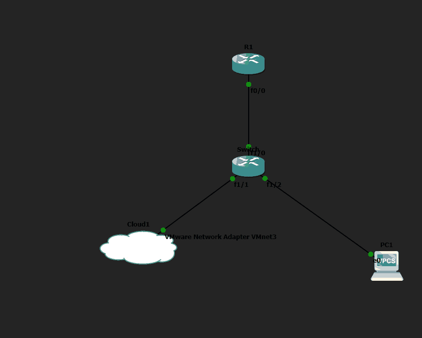

*Topología GNS3: R1, SW1, Cloud1 y equipo de prueba.*

### Evidencia 02 — Identidades de dominio

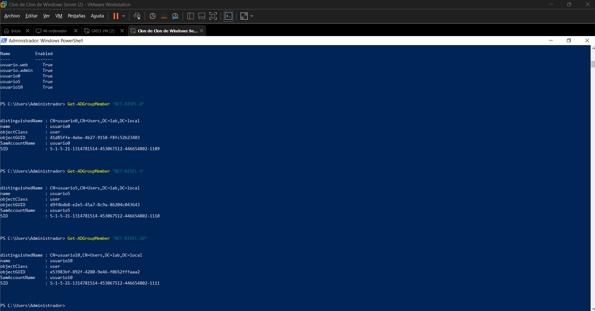

*Usuarios y grupos de Active Directory.*

### Evidencia 03 — Clientes NPS

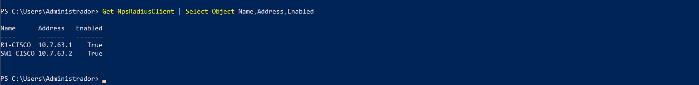

*Clientes RADIUS registrados.*

### Evidencia 04 — Servicio RADIUS

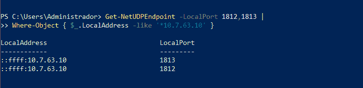

*Puertos UDP 1812 y 1813 escuchando en el servidor.*

### Evidencia 05 — Políticas de autorización

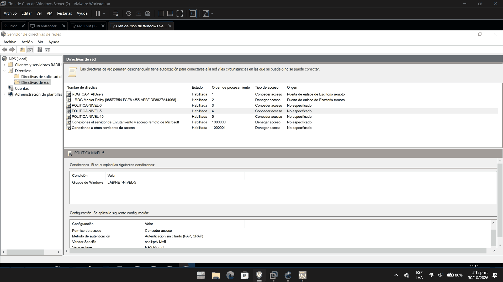

*Políticas de acceso NPS.*

### Evidencia 06 — Router R1: nivel 5

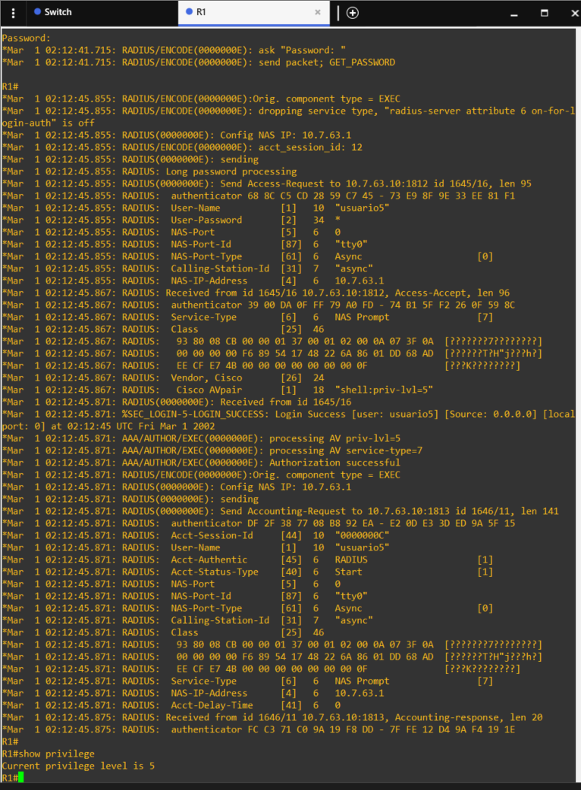

*R1, prueba de acceso con usuario de nivel 5.*

### Evidencia 07 — Router R1: nivel 10

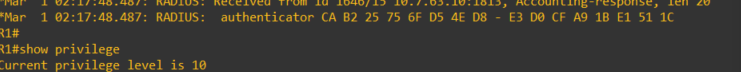

*R1, Current privilege level is 10.*

### Evidencia 08 — Router R1: nivel 0

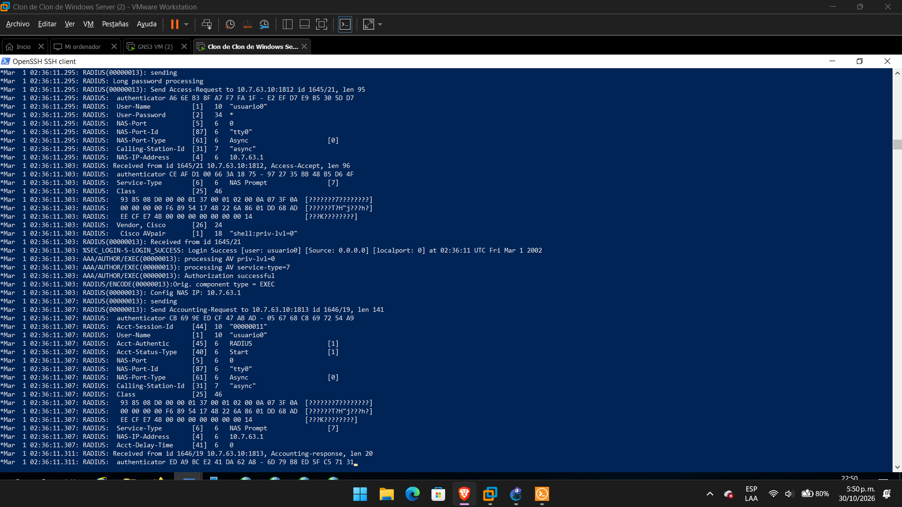

*R1, Access-Accept y Cisco AVPair nivel 0.*

### Evidencia 09 — Switch SW1: nivel 5

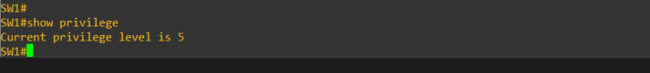

*SW1, Current privilege level is 5.*

### Evidencia 10 — Switch SW1: nivel 0

*SW1, autorización RADIUS de nivel 0.*

### Evidencia 11 — SW1: configuración

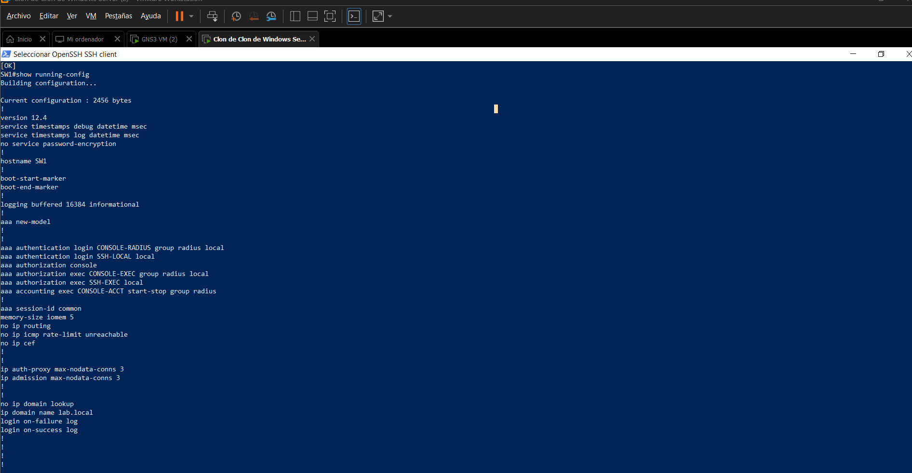

*SW1, fragmento visible de running-config.*

### Evidencia 12 — SW1: estadísticas

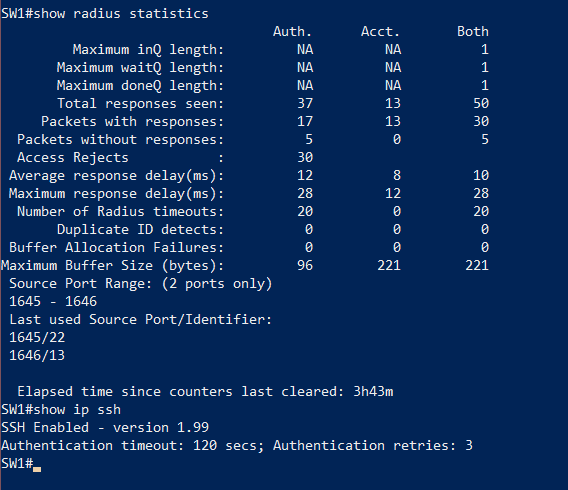

*SW1, estadísticas RADIUS y versión SSH.*

### Evidencia 13 — SW1: auditoría

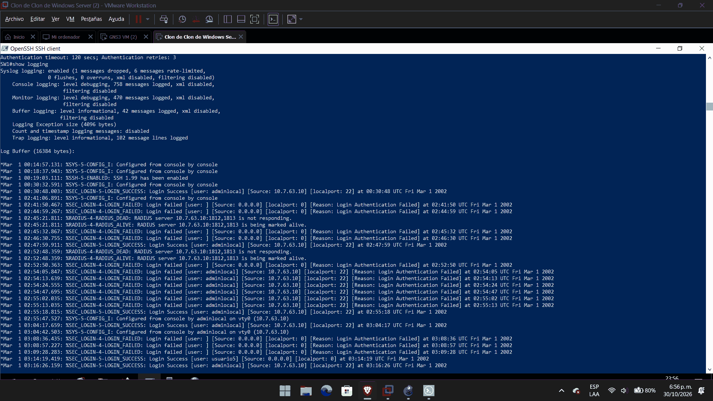

*SW1, registro de eventos y autenticaciones.*

### Evidencia 14 — R1: configuración

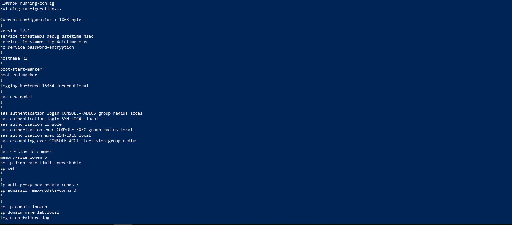

*R1, fragmento visible de running-config.*

### Evidencia 15 — R1: controles de acceso

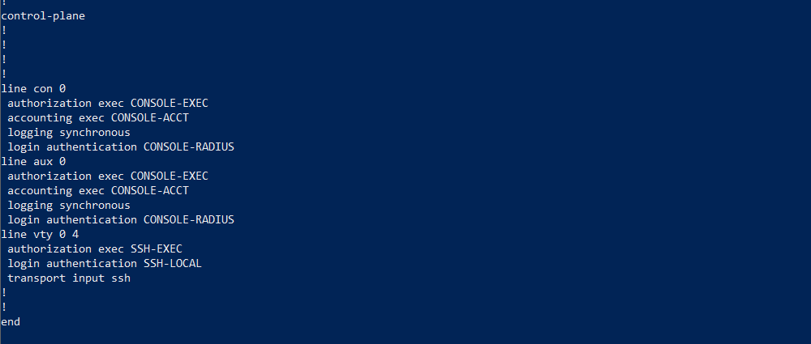

*R1, configuración de consola AUX y VTY.*

### Evidencia 16 — R1: auditoría

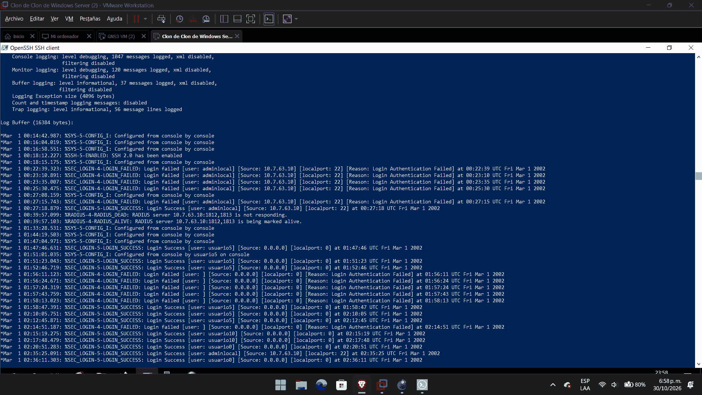

*R1, registros de accesos fallidos y exitosos.*

### Evidencia 17 — R1: estadísticas

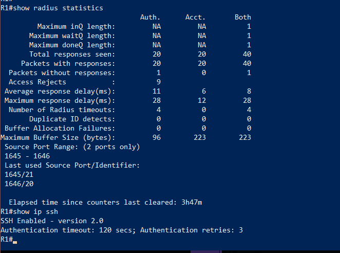

*R1, estadísticas RADIUS y SSH.*

### Evidencia 18 — R1: interfaces

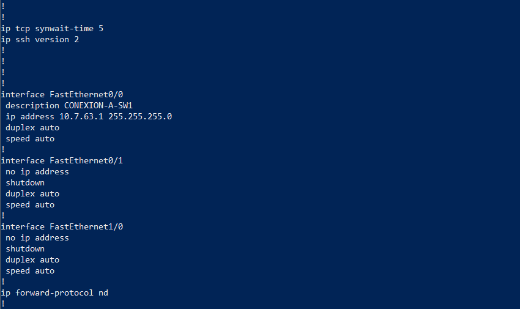

*R1, interfaz y direccionamiento IP.*
